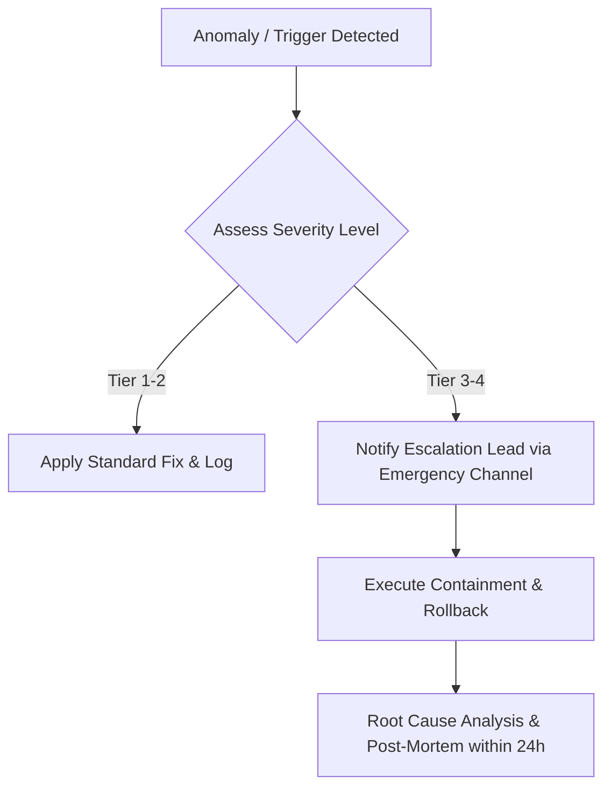

# Rto Mitigation Master Playbook

## Operational Playbook: Cash on Delivery (COD) Return-to-Origin (RTO) Mitigation Playbook
Standard operating guidelines for **Cash on Delivery (COD) Return-to-Origin (RTO) Mitigation Playbook** handling critical workflows and escalation thresholds.

### Scope & Mission
Build an open-source COD Return-to-Origin (RTO) mitigation toolkit for MENA: 1) operational playbook (Pre-Purchase Friction, WhatsApp 1-Click Confirmation, Prepaid Incentive Surcharges, Courier SLA Tracking, Blacklist Governance), 2) WhatsApp automated confirmation message templates (Arabic and English), 3) Python risk scoring script (`rto_risk_scorer.py`), 4) Courier handover reconciliation sheet.

---

## Multi-Tier Escalation Matrix

| Severity Level | Trigger Condition | Max SLA Response | Authorized Owner | Immediate Action Protocol |
| :--- | :--- | :--- | :--- | :--- |
| **Tier 1 (Low)** | Isolated metric anomaly (&lt; 10% variance) or minor ad comment inquiry | 4 Hours | Channel Specialist | Standard response or minor budget adjustment |
| **Tier 2 (Moderate)** | Discrepancy &gt; 25% or repeated negative sentiment cluster | 60 Mins | Senior Growth Lead | Pause anomalous ad sets; initiate data-layer triage |
| **Tier 3 (High)** | Platform policy strike, tracking outage, or critical SLA breach | 15 Mins | Head of Marketing | Activate holding statement; execute rollback playbook |
| **Tier 4 (Critical)** | Regulatory inquiry or complete revenue pipeline halt | Immediate (5m) | Executive Team | Full campaign freeze; incident commander assigned |

## Decision Logic Flow

---
*Operational standard maintained by @mahmoudabdelnaby1.*
